  

  
  

## 👋 Hi, I'm Jack

A developer from **Malaysia**. I build websites, apps and AI assistants that take the busy work off your hands.

## 💡 Problems I solve

| If you… | I can build… |
| :-- | :-- |
| 📱 can't reply to every customer on WhatsApp | an **AI assistant** that answers 24/7, recommends products, takes orders and passes tricky chats to you |
| ⏳ lose hours to repetitive work | **automation** that does the reports, data entry and research, so you only check and approve |
| 🛒 need a website, online shop or admin system | a **fast, clean site** that works on phone and computer |
| 💡 have an idea for an app | a **working app** for Android, Windows and Mac, launched in weeks, not months |
| 🤔 want to use AI but don't know where to start | a **simple AI setup** that fits your business and your budget |

## ✅ Real results

- 💬 **AI salesperson on WhatsApp.** Replies to shoppers day and night, spots serious buyers, places orders, and hands over to staff when needed. Live for an online store.
- 📲 **[Shuttle](https://github.com/JackWorld99/shuttle).** Send photos and files between phone and computer in full quality. Built and released for Android, Windows and Mac in under two weeks.
- 🏢 **An AI "team".** AI staff for research, content, finance and risk that meet, discuss and hand me a report to approve.
- 📡 **Model Radar.** Picks the best and cheapest AI for each job, so AI costs stay low.

## 🤝 Why me

- 🗣️ Plain talk, no tech jargon. English, 中文 or Bahasa Melayu.
- ⚡ Fast delivery. You see progress early and often.
- 💸 Budget-friendly AI that doesn't run up big bills.

## 📫 Let's talk

Tell me what's slowing your business down: **[jackwongportfolio520@gmail.com](mailto:jackwongportfolio520@gmail.com)**

## ☕ Buy me a coffee

  
  

<b>🧰 For developers: tech stack & open-source projects</b>

 

**AI:** Claude · Gemini · MCP · RAG · AI agents · Ollama · llama.cpp · Hugging Face · OpenRouter · Cloudflare Workers AI

 

Most of my code lives in private company repos (5,000+ commits in 2026). Public projects:

| Project | What it does |
| :-- | :-- |
| [MERN User Management System](https://github.com/JackWorld99/MERN-User-Management-System) ⭐ 16 | User accounts and roles on MongoDB, Express, React & Node |
| [YouTube Video & Audio Downloader](https://github.com/JackWorld99/Youtube-Video-Audio-Downloader) | Download MP3 / MP4 without typing commands |
| [Laravel CRUD Role Permission](https://github.com/JackWorld99/Laravel-CRUD-Role-Permission) | Task management with user permissions |
| [Ecommerce Sanity Stripe](https://github.com/JackWorld99/Ecommerce-Sanity-Stripe) | Online shop with Stripe checkout |

Shuttle is built on the open-source [LocalSend](https://github.com/localsend/localsend).

